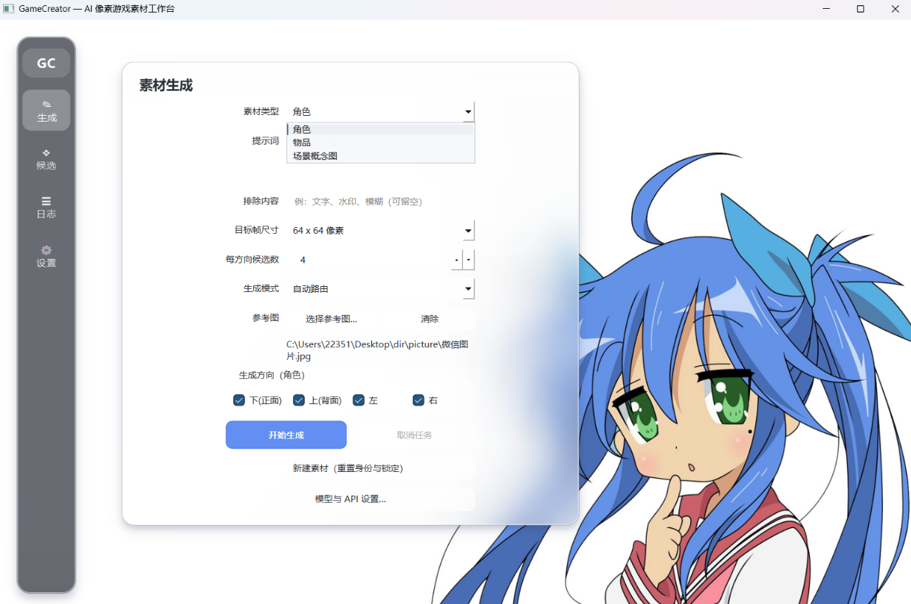
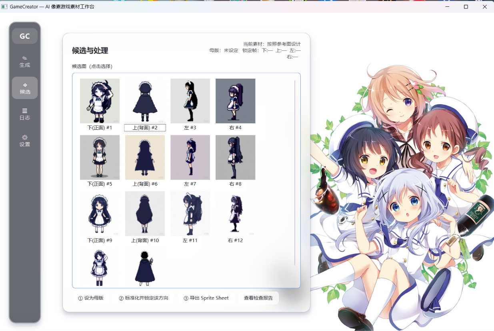

# GameCreator — AI 像素游戏素材生成工作台

按《AI像素游戏素材生成平台技术路线》实现的 MVP：**结构化素材需求 → AI 生成 → 素材标准化 → 确定性检查 → 导出**，桌面程序使用 Qt 6 + C++17。

## 界面预览

**素材生成**：提示词 / 参考图 / 目标帧尺寸 / 四方向勾选，生成模式可在自动路由、云端 API、本地 ComfyUI 之间切换。



**候选与处理**：同一角色的多方向候选并排对比，选定母版后逐方向标准化锁定，再导出 Sprite Sheet 与引擎格式。



## 功能（MVP）

- **角色**：提示词 / 参考图输入 → 多候选生成 → 选定唯一母版 → 四方向（下/上/左/右）生成（自动引用母版保持身份一致）→ 标准化（背景去除、透明边、**像素友好降采样（众数+轮廓保护）**、**母版统一色板量化**、脚底锚点）→ 打包 Sprite Sheet + 引擎无关元数据 JSON
- **物品**：武器 / 药水 / 宝箱 / 宝石等，单帧标准化导出（透明 PNG + 元数据）
- **场景概念图**：整图像素化 + 量化，按目标尺寸 2× 输出（如 64 → 128×128），保留更多画面细节
- **结构化提示词策略（PromptPolicy）**：生产规则 + StylePack（光照/透视）+ 用户描述 + 方向 VIEW + 一致性要求 + 完整负面清单，云端与 ComfyUI 适配器共用；`gpt-image` 系列自动请求透明背景
- **双重审查**：确定性硬性检查（帧尺寸/透明边缘/贴边/颜色数/方向齐全/锚点）+ 视觉启发式审查（轮廓覆盖、明暗层次、细节丰富度、方向间色彩漂移、身高一致性），报告落盘
- **版本管理**：原始输出、处理帧、导出、检查报告全部分版本保存在项目目录，永不覆盖

## 目录结构

```
GameCreator/
├── CMakeLists.txt
├── config.example.json          # 配置模板（首次运行会自动生成 config.json）
├── workflows/comfyui_example.json  # ComfyUI 工作流模板（含占位符示例）
└── src/
    ├── core/        # AssetSpec / ReviewReport / 公共类型
    ├── models/      # 统一模型适配层：Mock / OpenAI 兼容云端 / ComfyUI + 路由
    ├── factory/     # 素材工厂：背景去除/裁切/降采样/量化/锚点/图集
    ├── checks/      # 确定性程序检查
    ├── storage/     # 项目存储（目录 + JSON 版本历史）
    ├── orchestrator/# 任务编排器（状态机、按方向拆分、失败统计）
    └── ui/          # Qt 主窗口
```

## 构建与运行

### 一键方式（本机已配好工具链 `F:\qt-toolchain`，实测可用）

```
build.bat    # 配置 + 编译 + 自动部署 Qt 运行时（windeployqt）
run.bat      # 启动创作工作台
```

工具链内容：Qt 6.7.3 (win64_mingw) + MinGW-w64 GCC 13.1 + CMake + Ninja，位于 `F:\qt-toolchain`。

命令行等效操作：

```bat
cd /d "F:\vs 2022\code\GameCreator"
build.bat
run.bat
```

### 无 GUI 流水线自测（mock 模式端到端）

```
build\PipelineTest.exe
```

验证：生成 → 母版 → 四方向（引用母版）→ 标准化 → 检查 → Sprite Sheet 导出，产物在 `build\test-projects\`。

### 方式二：全新环境

依赖：**Qt 6.7+（MinGW 64 位）**、**MinGW-w64 GCC 11+**（Qt 官方在线安装器可一并装好）、**CMake 3.19+**、**Ninja**。本机老 MinGW GCC 8.1 无法编译 Qt 6，请使用 Qt 自带的 MinGW（如 `Tools\mingw1310_64`）。

```bash
cmake -G Ninja -B build -DCMAKE_BUILD_TYPE=Release \
      -DCMAKE_PREFIX_PATH=<Qt安装路径>/6.7.3/mingw_64
cmake --build build -j
```

> 注意：直接双击 `build\GameCreator.exe` 即可运行——构建时 windeployqt 已把所需 DLL
> （含 `platforms\qwindows.dll`）部署到 exe 旁；没有它们程序会静默退出。
> 运行项目目录为仓库根目录的 `projects\default\`。素材项目已加入 `.gitignore`，不会提交到仓库；
> 首次启动会自动把旧的 `build\projects` 复制过来（旧目录保留），也可用环境变量
> `GAMECREATOR_PROJECTS_DIR` 指定其它位置。

## 生图模型配置

程序默认运行在 **离线模拟（mock）模式**：不调用任何外部服务，用程序化生成的像素素材验证整条流水线，开箱即用。

接入真实模型：编辑 exe 目录下的 `config.json`（首次运行自动生成）：

| 字段 | 说明 |
|---|---|
| `model.mode` | `auto`（默认：云端已配→云端，否则 ComfyUI→mock 回退）/ `mock` / `cloud` / `comfyui` |
| `model.cloud.base_url` | 生图网关地址（含 `/v1`）。推荐 `https://api.siliconflow.cn/v1`。DeepSeek 只有对话接口，不能填 |
| `model.cloud.api_key` | 留空则读环境变量 `GAMECREATOR_API_KEY`（密钥不写入源代码） |
| `model.cloud.model` | 模型名。连通测试用 `black-forest-labs/FLUX.1-schnell`。硅基流动会自动改用 `image_size`，并解析 `images[].url` |
| `model.comfyui.*` | 本地 ComfyUI 地址与工作流模板路径 |

**切换到真实模型**：点击界面左侧「模型与 API 设置…」直接在程序里填写 base_url、API 密钥、模型名并保存（写入本机 config.json，密钥不进源代码）；也可以手动编辑 exe 目录下的 `config.json`。默认 `auto` 模式：填了密钥自动走云端，否则回退离线模拟。

硅基流动连通测试只改 `build/config.json` 的 `api_key`，地址和模型已经预填。先不要上传参考图，候选数先改成 1，生成一张确认能下载图片。返回的图片链接约 1 小时失效，程序会立即下载保存。参考图多角度目前不能走硅基流动的文生图接口。

ComfyUI 用法：在 ComfyUI 里把工作流导出为 **API 格式** JSON，替换占位符后指向它。可用占位符：`{{PROMPT}} {{NEGATIVE}} {{SEED}} {{WIDTH}} {{HEIGHT}}`，以及参考图 `{{REFERENCE_IMAGE}}` / `{{REFERENCE_IMAGE_1..N}}`（程序自动通过 `/upload/image` 上传母版/参考图并回填文件名，模板中用 LoadImage + IP-Adapter 等节点消费，见 `workflows/comfyui_example.json`）。

**风格包**：`projects/<项目>/project.json` 中的 `stylePack`（光照方向、透视、默认尺寸/色板数）会进入每次生成的提示词策略。

## 导出格式（点「③ 导出」后可选）

导出时会弹出对话框，**自选格式与目标目录**（项目目录内同时永久保留一份存档，永不覆盖）：

| 格式 | 产出 | 适用 |
|---|---|---|
| 通用 Sprite Sheet | `*-sheet.png` + JSON 元数据（帧尺寸/方向行/锚点/色板） | 所有引擎 / 自研 |
| 单帧 PNG 文件夹 | `*_frames/<名>_<方向>.png` × N + 索引 JSON | 直接拖入引擎 / 逐帧编辑 |
| **Godot 4** | `*-sheet.png` + `*.tres`（SpriteFrames，idle_down/up/left/right 动画已建好）+ 使用说明 | 拖入 Godot 项目即用（记得 Import 关 Filter） |
| **Phaser / PIXI** | `*-sheet.png` + TexturePacker JSON Hash（pivot 已设底部中心） | Web 游戏框架 |

## 使用流程（角色为例）

1. 素材类型选「角色」，输入提示词，选择方向（默认正面）
2. 点「开始生成」→ 右侧出现候选图
3. 挑一张最满意的点「① 设为母版」
4. 再勾选其它方向生成（会自动引用母版保持身份一致）
5. 每个方向选一张点「② 标准化并锁定」
6. 点「③ 导出 Sprite Sheet」→ 自动运行确定性检查并弹报告

导出结果在 `projects/default/assets/<id>/exports/`：`*-sheet.png`（4x 预览 `*-preview.png`）与 `*-sheet.json`（帧尺寸、方向行映射、锚点、调色板）。

## 背景壁纸

在线壁纸优先使用 JPEG/PNG 图源（`t.mwm.moe`、`loliapi` 只返回 WebP；当前 Qt 构建缺少 WebP 插件时会自动跳过）。
取到的图片会缓存到 `%LOCALAPPDATA%\GameCreator\GameCreator\cache\wallpapers`，冷启动或断网时先显示缓存、再后台补新图；
默认每 30 秒轮换，设置页可切换「在线 / 本地 / 在线优先」，本地图片放 `build\wallpapers\`。

## 后续路线（对应技术路线阶段 2-3）

- 独立视觉审查模型接入（ReviewReport 已预留 `stage: vision`）
- 单方向 / 单帧定向重试、局部遮罩重绘
- ComfyUI 姿态 / 深度 / ControlNet 控制与批量生成
- Godot 审查运行时（沙盒移动 / 碰撞 / 遮挡测试）
- SQLite 版本索引（当前为 JSON 文件存储，接口不变）
